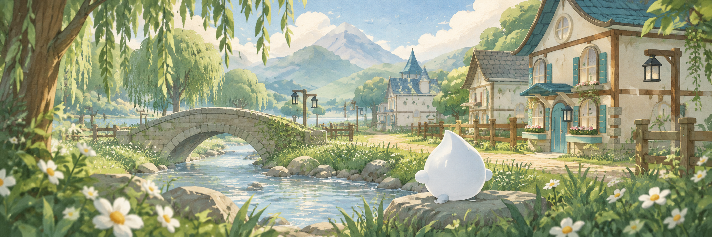
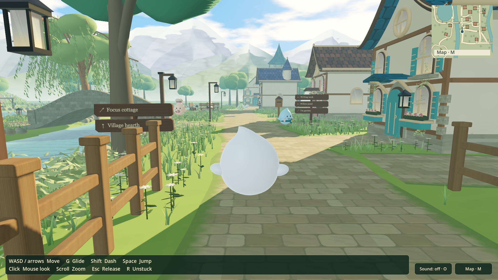

# Hearthwillow

A quiet village to wander through. Meet the residents, spend time with animals,
grow something, cook a meal, or settle into the writing nook and focus cottage.

## Download and play

Get the game from [GitHub Releases](https://github.com/CipherAtlas/Hearthwillow/releases).
The first preview downloads are being prepared; they will appear there when the release is published.
Choose a game ZIP below, rather than GitHub’s **Source code** archives. You do not
need Godot installed.

| Your computer | Download |
| --- | --- |
| Mac — Apple Silicon or Intel | `Hearthwillow-macOS-universal.zip` |
| Windows — Intel or AMD 64-bit | `Hearthwillow-Windows-x64.zip` |

**Mac:** unzip, drag `Hearthwillow.app` into Applications, and open it. This preview
uses free ad-hoc signing and is not notarized by Apple. If macOS blocks it, try
opening it once, then go to **System Settings → Privacy & Security → Open Anyway**.
[Apple’s instructions](https://support.apple.com/en-us/102445).

**Windows:** extract the entire ZIP into a folder and open `Hearthwillow.exe`.
Keep the accompanying files together. The Windows preview is unsigned and has
not yet been tested on a Windows PC. SmartScreen may warn; where Windows permits
it, **More info → Run anyway** opens the app. Smart App Control or a managed PC
may block unsigned apps.

## Getting around

| Action | Default controls |
| --- | --- |
| Move | WASD or arrow keys |
| Dash / jump / glide | Shift / Space / G |
| Look / zoom | Mouse / scroll wheel |
| Release the mouse | Escape; click the game to capture it again |
| Interact / talk or feed | E / F — follow the nearby action prompt |
| Map / basket / settings | M / I / comma |
| Sound / return to a safe spot | O / R |

Sound starts off; press **O** to turn it on. Keys can be changed in Settings.

This is an early **single-player, offline** preview. Notes, preferences and
activity progress save locally. It does not connect to the browser village’s
multiplayer world or import browser saves. Graphics and performance are still
being refined; no particular frame rate is promised.

The banner is generated illustration; the image above is an actual Mac gameplay capture.

## Source and credits

To explore the source, open `project.godot` in **Godot 4.7.2**. The project uses
the Mobile renderer: Metal on Mac, Vulkan or Direct3D 12 on supported Windows PCs.
See [building the downloads](docs/RELEASES.md) and [project status](MILESTONE.md).

Art, music, recordings and font credits are in
[the asset credits](assets/village/CREDITS.txt). Third-party license notices are
included with the downloads. Original project code and artwork retain their
existing rights; public availability does not grant a blanket open-source license.

Found a problem? [Open an issue](https://github.com/CipherAtlas/Hearthwillow/issues)
with your operating system, graphics card and what happened.
